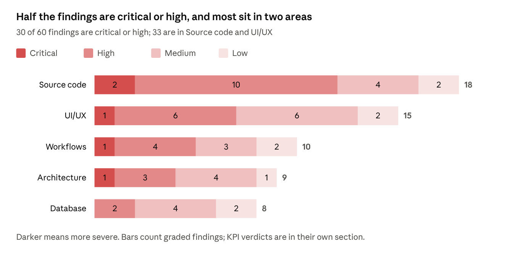
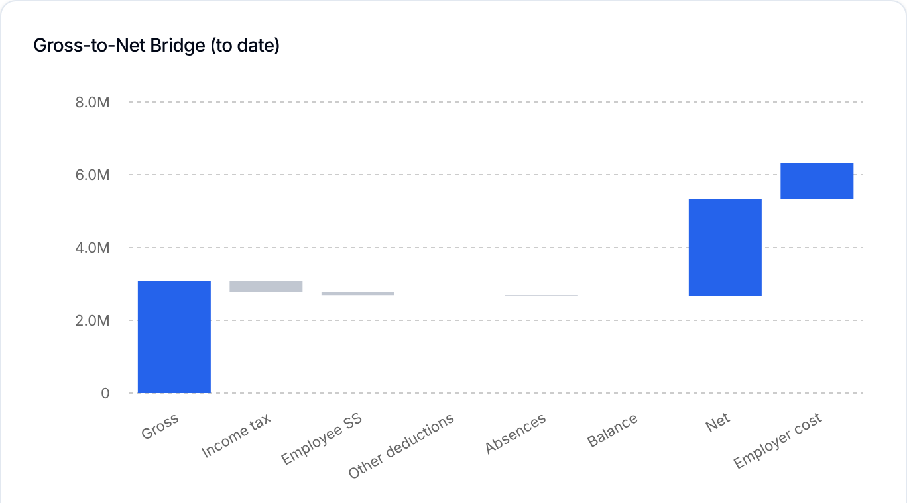
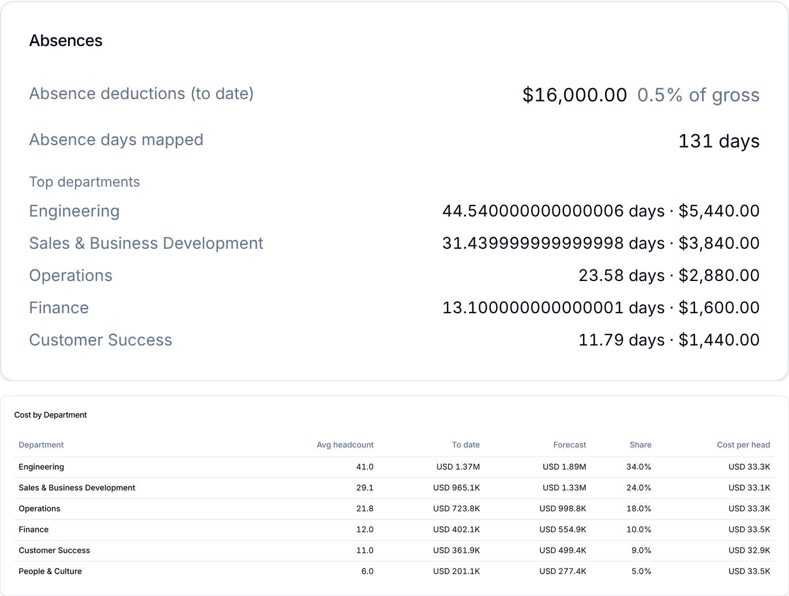
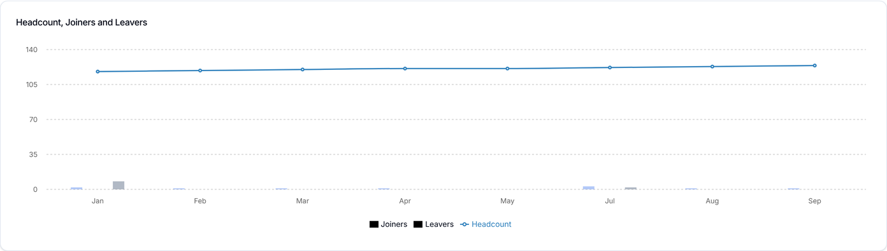

# Annual Salaries Dashboard: Deep Review of Commit 45c9f13

> Living version: https://claude.ai/code/artifact/ec962b38-739c-4f52-8bd4-0694afc3c3e4 (this file is a snapshot for the repo).

Oct 11, 2026 · @Radwan

## Verdict

**Not ready to merge.** Run against a real Postgres, the Annual Salaries page throws "Invalid time value" for a USD company and shows an empty year for any other currency, because the router reads camelCase fields from snake\_case rows. With that fixed, the to-date totals are right (gross 30,800, net 24,640, employer cost 35,420 on seeded data), but the forecast, department, year-on-year, turnover and AI figures are still wrong.

**Worth keeping:** a pure calculation library separate from React and the database; de-duplication of re-uploaded periods; tenant scoping (a second company sees nothing); generated calendars for 52/53 weeks and 26/27 fortnights; no horizontal page scroll from 390 to 1920 px; 36 annual unit tests; 2,000 employees × 26 periods computed in 60 ms.

**What blocks AAA, in order:**

1. The router's row mapping makes the page unusable for every company with data (C1).
2. CI has failed on every run since at least 29 June, so nothing gates a merge (W1).
3. The forecast leaves out uncategorised earnings: full year 31% low in a probe, and a negative net forecast for uploads without component columns (C2).
4. Prior-year method inverted and misaligned (44% low), department cost double-counted (17% high), year-on-year shows 200% for no change, and the waterfall draws Net at twice its height (C3–C10, U1).
5. The AI model `claude-sonnet-4-20250514` was retired on 15 June 2026, so every AI call in Drift now fails silently ([Anthropic model deprecations](https://platform.claude.com/docs/en/about-claude/model-deprecations)) (A2).
6. No role checks on company-wide writes, no indexes on the tables every query scans, and a migration that fails when re-run (A4, B1, B2).

The plan at the end fixes these in 8 phases and 48 steps. Steps 1–30 and 32–34 make it correct and safe enough for a first release; the remaining steps make it AAA.

## Tests run and results

Unit tests pass, but every check that touches the real database, the UI or the gates fails. All runs are on commit 45c9f13 (branch `feat/annual-dashboard`), Node 22, pnpm 11.8.0.

| Check | How it was run | Result |
| --- | --- | --- |
| Install | `pnpm install` | Pass |
| Type check | `pnpm turbo typecheck --continue` | **Fail: 95 errors** in `@saas/ai`, `@saas/db`, `@saas/payroll-core` (84 already on `main`; +11 from this branch, all TS6059 rootDir). `@saas/web` passes. |
| Lint | `pnpm lint` | **Fail:** `next lint` has no ESLint config and stops at an interactive prompt |
| Unit tests | `pnpm --filter @saas/payroll-core test`, `pnpm --filter @saas/ai test` | Pass: 109/109 (36 annual) and 17/17 |
| All tests | `pnpm test` | **Fail:** `apps/web` has no test files, so vitest exits 1 |
| Build | Vercel preview of 45c9f13 | Pass: Next 15.5.19, `/annual-salaries` 21.8 kB (296 kB first load), env warnings |
| CI | GitHub Actions history | **Fail on every run since 29 June:** CI and Deploy stop at pnpm setup |
| Migrations | 0000–0004 applied to Postgres (PGlite) | Pass; re-running 0004 fails ("relation annual\_budgets already exists") |
| Router on Postgres | Real `annual` router through drizzle `neon-http`, two seeded companies | **Fail:** USD company → "Invalid time value"; LBP company → empty year, currency USD. With column aliases added: correct to-date totals |
| Engine probes | 19 spec scenarios against `computeSummary` and helpers | **18 of 19 fail** (Source code C2–C12) |
| AI probes | Parser and fallback text with a mocked model | **3 of 3 fail** (C11) |
| Router probes | Roles, budgets, amounts, cache, tenant isolation | **7 of 8 fail**; tenant isolation passes |
| UI render | Real components, engine-built fixtures (USD and LBP), 390/1280/1440/1920 px, light and dark | No page-level overflow; 15 visual and UX defects (UI/UX) |
| Query plan | `EXPLAIN` of the main CTE | Sequential scans only: no usable index |

The probe tests (cited below as P1–P19 for the engine, R1–R9 for the router, AI1–AI3 for the AI module) are attached to this review as files. Step 5 of the plan adds them to the repo as regression tests, so each fix turns one red check green.

## Findings at a glance



Five findings are critical: the router's row mapping (C1), the forecast's missing earnings (C2), the waterfall (U1), the untyped data boundary (A1) and the dead CI (W1). Fix those first; they are steps 1, 7, 11 and 32 of the plan.

## Architecture

The layering is right (pure engine, thin router, client UI); the boundaries between the layers are what fail: untyped SQL rows, a query with side effects, no roles, and the summary rebuilt twice per page.

| ID | Severity | Finding | Fix (plan step) |
| --- | --- | --- | --- |
| A1 | Critical | Raw `db.execute` rows are cast with `as unknown as` and never validated. Postgres returns snake\_case keys, the code reads camelCase, TypeScript cannot see it, and no test runs the router against a database (R2, R3). | Parse every raw row with a zod schema at the router boundary; run a Postgres-backed router test in CI (4, 7) |
| A2 | High | `DEFAULT_MODEL` is `claude-sonnet-4-20250514`, retired on 15 June 2026. `callClaude` swallows the error, so rule-based text is returned and cached under the model's name (R8). This hits every AI feature in Drift, not only this page. | Model from `ANTHROPIC_MODEL` (default `claude-sonnet-5-5`); return `{text, error}`; store the source (AI or rules); never cache a failure (9) |
| A3 | High | `getInsights` is a tRPC query that calls the model and writes the cache. Queries refetch on mount and focus, `force` rides in the query input, and there is no rate limit (Upstash is configured but unused). | `getInsights` reads the cache only; `generateInsights` is a mutation, rate-limited per company (23) |
| A4 | High | No authorization on company-wide writes: a viewer can recategorise components and set the budget (R6). | An editor-only procedure (admin, manager) for every annual mutation (22) |
| A5 | Medium | One page view runs `getSummary` and `getInsights`, each 13 SQL round trips (R4), each re-running the same CTE with `SELECT *` including the components JSON. | Load once (CTE once, needed columns, one `db.batch`), memoize the summary, build the insight payload from it (26) |
| A6 | Medium | The default currency ignores `companies.currency_code` and falls back to the literal "USD". | Company currency first, then the most frequent in the year (8) |
| A7 | Medium | Missing past periods drop out of "full year". With June missing, the full year is 11 months and the budget variance hides about USD 390K. | Estimate missing past slots with the chosen method and label them as estimates (14) |
| A8 | Medium | No single slot model: periods are matched to calendar slots by exact end date in four places, so 26th–25th payrolls and off-cycle runs break coverage, labels, forecast and year-on-year (P7, P9). | One `assignSlot()` used by every module (10) |
| A9 | Low | Pre-existing: `/dashboard`, `/detailed`, `/payroll-periods` and `/settings/*` build as static pages. The spec warns this already caused a cached-auth incident. | `export const dynamic = "force-dynamic"` in the (main) layout, so every page below it renders per request (6) |

Target flow after the plan: upload → `payroll_periods` and `employee_snapshots` (plus per-period aggregates) → typed loaders → pure engine → one cached `AnnualSummary` → UI and the insight payload. The model is reached only through a rate-limited mutation.

## Product design against the spec

Most of the spec's P1 scope is on screen, but 14 spec items are missing or behave differently, and an owner-grade annual view needs seven things the spec left out or deferred.

| Spec item | Status | Gap | Plan step |
| --- | --- | --- | --- |
| KPI 9 Headcount and turnover | Missing | Turnover is computed but never shown; formula counts joiners; no annualised rate | 17, 34 |
| KPI 5 Salary components | Partial | To date only: no Forecast or Full-year column; no earnings balance row, so the table does not add up to gross | 11, 36 |
| 4c Taxes and social security as stacked bars by period | Missing | A totals card only | 35 |
| 4d Absences: "No absence columns mapped" plus a button to categorise | Partial | Message shown, button missing | 36 |
| Stage 2: period type, currency and method as URL params | Missing | Only the year is in the URL; a view cannot be shared or reloaded | 38 |
| 3.4 `getYears` returning `{years, defaultYear}` | Dead code | Never called; `page.tsx` repeats the logic | 21 |
| 3.4 Warning codes | Partial | LOW\_HISTORY and DUPLICATES\_IGNORED never raised; MULTI\_CURRENCY instead of MIXED\_CURRENCY; warnings are strings the UI parses | 19 |
| 4.1 Default currency: the organization's own first | Missing | Literal USD fallback | 8 |
| 4.4 Balancing lines `other_earnings_balance` and `unreconciled_deductions` | Partial | Only the second exists | 11 |
| 4.5 Forecast methods | Wrong | No earnings balance; run-rate balance uses the last period; prior-year growth, availability and slot alignment wrong; assumption sentence differs | 11–13 |
| 4.6 First period empty when there is no prior year | Wrong | Returns 0 joiners and 0 leavers | 17 |
| 4.7 Forecast vs last *full* year | Wrong | Uses an incomplete last year and prints a ratio as if it were a change | 18 |
| 2 Global rules | Not met | Migration 0004 not idempotent; type check and lint red when stages were reported done; `docs/ANNUAL_DASHBOARD_SPEC.md` never committed | 2, 3, 6, 30 |
| 6 Test scenarios | Partial | The prior-year test asserts the inverted availability rule and uses impossible dates (2026-04-31, 2026-06-31); no bridge test with uncategorised earnings; classifier traps cover the spec's word list only | 5, 13 |

AAA additions beyond the spec, each in the plan:

- Excel export and a PDF board pack of the year (step 42): owners take these numbers to the board and the auditor.
- Budget by basis (gross, employer cost or net) with monthly phasing and a cumulative actual-plus-forecast line against budget (25, 37).
- Scenario planner: headcount change, salary increase, one-off bonus month (43).
- Drill-down from a bar or department to its periods, and to employees for admins only (44).
- Fiscal-year start month (45) and an audit trail of category and budget changes (29, 46).
- A data-quality centre built from structured warnings, each with its fix action (19, 33).
- Last year's line on the period chart (35).

## UI/UX

The layout holds at every width (no page-level overflow from 390 to 1920 px), but three charts mislead and most labels and states need work. The figures are the real components rendered with engine-built data for a 124-person company.



*Figure 1. Net is drawn from 2.67M up to 5.3M, Employer cost floats above it, and the axis runs to 8M for a 3.09M gross.*

| ID | Severity | Finding | Fix (plan step) |
| --- | --- | --- | --- |
| U1 | Critical | The waterfall adds Net and Employer cost onto the running total instead of starting totals at zero (Figure 1). The one chart meant to explain where gross goes shows it wrong. | Totals from zero, deductions as down-steps; a second group from Gross up to Total employment cost; horizontal bars below 640 px (32) |
| U2 | High | The warnings strip strips the code and shows bare "Jun 2026" and "Night Shift Premium" with no title; each line is `role="alert"`, so screen readers interrupt for every one. | Structured warnings with a title, detail and fix button; one polite live region (33) |
| U3 | High | Absence days print float noise: "44.540000000000006 days" (Figure 2). | One shared number formatter, at most 1 decimal for days (36) |
| U4 | High | Headcount chart: joiners and leavers vanish on a 0–140 axis, their legend swatches are black, and a weekly payroll gets "Jan Jan Jan Jan" labels (Figure 3, P18). | Flows on their own scale, explicit fills, slot labels (W1…W52) (35) |
| U5 | High | KPI cards mix scopes and formats: "Total Employer Cost" is a full-year forecast but does not say so; "Average Cost per Employee" leads with a year-to-date figure; subtitles put "$3,089,200.00" under "USD 2.67M" and show "up to 2026-09-30". | A scope tag per card (To date, Full-year forecast), one money formatter, period names (34) |
| U6 | High | Budget input: placeholder cut to "Set annual bu", saves while you type (600 ms), no error message, no thousands separators; "year elapsed" reads 67% instead of 75% when June is missing. | Budget dialog with formatted input, explicit Save, error toast; elapsed from the last slot (37) |
| U7 | High | AI card: developer copy ("cache by year + method"), raw `run_rate` in the text, rule-based bullets labelled with a model name, any failure shown as "no API key", and a privacy line that is not true when a key is set. | Source badge (AI or rule-based), plain copy, a real error state, a company-level AI switch (41) |
| U8 | Medium | A missing period simply disappears from the period chart (no June bar), and there is no last-year reference. | Draw every expected slot: hatched if missing, outlined if estimated; add last year's line (35) |
| U9 | Medium | Tables show compact values (the spec asks for full values) and at 390 px hide columns behind an unmarked scroll; header cells are not sticky with the first column. | Full values, scroll shadow, sticky header and first column (36) |
| U10 | Medium | Accessibility: charts have no `role="img"`, label or text alternative; the Net/Gross toggle has no `aria-pressed`; category rows are clickable table rows with no keyboard or `aria-expanded`; the Taxes and Mix bars rely on colour alone. | Labelled charts with a hidden data table, real buttons, text legends (39) |
| U11 | Medium | The axis formatter has no billions: an LBP company sees a clipped "600000.0M". | `Intl.NumberFormat` compact notation (35) |
| U12 | Medium | The empty state never shows: coverage expects 12 periods even with no data (P8), so a new year renders a page of zeros. | Empty state when nothing is uploaded (38) |
| U13 | Medium | Every load and year change fetches the summary twice: the response's cadence and currency are copied into state, which changes the query key. | Controls in the URL; server-resolved defaults returned, not copied (38) |
| U14 | Low | Two-column rows leave large blank areas under the Taxes and Components cards. | `items-start` or a rebalanced grid (38) |
| U15 | Low | `error.tsx` prints the raw error message; the Mix card renders an array (`{[formatPct(…)]}`); budget variance lacks the spec's red/green with an icon. | Fix in place (37, 38) |



*Figure 2. Day counts print floating-point noise, and every department's cost per head (USD 32.9K–33.5K) is above the company's average cost per employee (USD 30.0K). That cannot be true; it comes from finding C6.*



*Figure 3. Joiners and leavers are invisible against the headcount axis, and their legend swatches are black, which disappears in dark mode.*

At 390 px the waterfall labels overlap, and the KPI subtitles truncate with the full value only in a hover title, which a touch screen cannot open.

## Source code

Two critical and ten high defects, each reproduced by a probe; the numbers below are probe output against the spec's expected value. Paths are under `apps/web/src/server/routers/` (router), `packages/payroll-core/src/annual/` (engine) and `packages/ai/src/` (AI).

| ID | Severity | Finding and evidence | Fix (plan step) |
| --- | --- | --- | --- |
| C1 | Critical | `annual.ts` reads `periodType`, `createdAt`, `negRows`, `employeeExternalId`, `periodEnd`, `currencyCode` from rows whose keys are snake\_case (lines 126, 144–145, 154, 217, 271). Line 188 then calls `new Date(undefined).toISOString()` and throws (R2); the setup lists become `[null]`, so currency defaults to USD (R3); MIXED\_SIGN can never fire. | Alias the columns (`period_type AS "periodType"`, …) and zod-parse the rows. Verified: with aliases the router returns 8 of 12 periods and correct totals (7) |
| C2 | Critical | Forecast gross is the sum of earnings categories only (`forecast.ts:171`). An uncategorised "Basic" gives forecast gross 400 instead of 4,800 and full-year net 8,333 instead of 12,000 (P1); an upload with only gross and net gives forecast net −800 (P2). | Add the earnings balance line and forecast it; with no earnings components, forecast gross and net directly (11) |
| C3 | High | `isPriorYearAvailable` (`forecast.ts:84–88`) needs last year to have a missing slot: a complete 2025 disables the method (P3, R4); a Jan–Jun 2025 enables it (P4). The shipped test asserts this inverted rule. | Spec rule: at least 3 of this year's elapsed slots and 1 remaining slot exist last year (13) |
| C4 | High | Prior-year growth divides this year's YTD by last year's full-year total (`forecast.ts:144–152`), and slots are matched by comparing 2025 end dates with 2026 end dates (line 158), so the same slot is never found: forecast 3,100 instead of 5,500, and a December 13th-month payment is lost (P5). | Align by slot index; growth over the same elapsed slots, clamped 0.5–2.0 (13) |
| C5 | High | Run rate carries the last period's unreconciled balance into every remaining period (`forecast.ts:185`): 400 instead of 50 (P6). The average method averages all periods, not the last 3. | Spec: average per actual period; last 3 for the average method (12) |
| C6 | High | Department cost adds employee deductions on top of earnings (`summary.ts:249`): 1,550 instead of 1,350 (P11), 17% high on seeded data (R4), and every department's cost per head exceeds the company average (Figure 2). | Department gross from SQL plus employer categories (15) |
| C7 | High | The period series called "Employer cost" holds on-costs only (`summary.ts:290`): 150 instead of 1,350 (P12), while the chart caption uses total employment cost. | Gross plus employer costs (16) |
| C8 | High | Slots are matched by exact end date (`periods.ts:91, 101`, `summary.ts:271–274`, `yoy.ts:86`). A 26th–25th payroll flags 7 months missing, forecasts August twice (13 periods in the year) and labels bars "2026-01-25" (P7); an off-cycle bonus run shows "4 of 12" and two March bars (P9). | One slot-assignment function; off-cycle runs merged into their slot (10) |
| C9 | High | Turnover is ((joiners + leavers) / 2) / average headcount (`headcount.ts:54–55`): hiring 4 people with no leavers reads 16.7% (P13). No annualised rate; the first period reports 0 instead of empty (P14); turnover is never shown. | Spec formula, annualised rate, null first-period flows (17) |
| C10 | High | `forecastVsLastYearPct` is a ratio × 100 against a possibly incomplete last year: 200% for an unchanged payroll (P15), 95.3% on screen for −4.7%; `pctChange` returns +100% when last year is zero (`yoy.ts:92–95`, P16). | Change in percent, only against a complete last year; null on a zero base (18) |
| C11 | High | `parseBullets` (`insights.ts:104`) strips leading digits: "2026 payroll…" becomes "payroll…" and "12.5% of gross…" becomes "% of gross…"; a preamble line becomes bullet one (AI1). The fallback adds overtime twice: variable share 13.8% instead of 10.0%, fixed plus variable 103.8% (AI2). The payload sends day counts as money and an unsorted top 10. | Keep only ` -  ` lines and their numbers; fix the ratio; money categories only, sorted (23) |
| C12 | High | The classifier misses 26 of 30 common column names (P17): "Basic", "Salary", "OT", plural "Other Deductions", "Transportation", "NSSF ER" (sent to employee), totals such as "Gross Pay", "Net Pay" and "Total Deductions" (which double-count if mapped), and French and Arabic headers. | Synonym table, plurals, ER/EE tokens, totals detector, French and Arabic packs, and the matched rule returned (20) |
| C13 | Medium | `listComponentCategories` sums every ready upload of the latest year in every currency (`annual.ts:422`): 38,000 instead of 28,000 (R5). | Reuse the valid-periods CTE for the selected currency (24) |
| C14 | Medium | `setComponentCategory` reads then inserts (race; the unique constraint exists, so upsert), never updates `updated_at`; the dialog saves N keys as N sequential requests. | One bulk upsert mutation (24) |
| C15 | Medium | The budget accepts "lbp" as a new currency, and an LBP-scale amount fails with "numeric field overflow" (R7). | Upper-case ISO code check; wider column (25, 28) |
| C16 | Medium | `callClaude` swallows every error (`client.ts:41`), uses the SDK's default timeout (10 minutes) and asks for 4,096 tokens to write five bullets. | Return the error; 20 s timeout, 1 retry, 800 tokens (9) |
| C17 | Low | Dead or misleading code: `getYears`, `absencesByDepartment`, `countsPerCadence` unused; `safeRatio` returns 1 on both branches; `roundMoney` turns NaN into 0 and hides bugs; a local named `window`; a `detectMissingPeriods` comment says leading gaps are never flagged, but they are (P19); test fixtures use 2026-04-31. | Remove or correct (21) |
| C18 | Low | Client hooks: `BudgetInput` leaves mutation rejections unhandled and omits effect dependencies; `CategoryManager` re-seeds the draft whenever the data object changes. | Fix with the UI steps (37, 40) |

## Database

The three new tables have the right shape (company-scoped, cascading deletes, unique keys), but nothing is indexed for the annual queries, one migration fails when re-run, and two columns are too loose or too small.

| ID | Severity | Finding | Fix (plan step) |
| --- | --- | --- | --- |
| B1 | High | No index serves the annual filters. `EXPLAIN` of the main CTE shows sequential scans of `payroll_periods` and of every tenant's `employee_snapshots`, and a page view runs about 10 such queries. | Two composite indexes (27) |
| B2 | High | Migration 0004 is not idempotent: a re-run fails with "relation annual\_budgets already exists" (R1). 0003 is idempotent. The spec requires `IF NOT EXISTS`. | Make 0004 idempotent if it has not reached production; make 0005 idempotent either way (30) |
| B3 | Medium | `component_categories.category` is a free `varchar(40)` (the spec asked for an enum); `updated_at` never changes; no record of who changed it. | CHECK constraint, `updated_by`, set `updated_at` on write (28) |
| B4 | Medium | `annual_budgets.amount` is `numeric(14,2)`, which tops out near 1 × 10^12. A 1,000-person payroll in LBP (about 1.2 × 10^12 a year) cannot be stored (R7). Currency is not constrained, and there is no basis or monthly phasing. | `numeric(20,2)`, ISO currency check, `basis` column, optional phasing table (25, 28) |
| B5 | Medium | `annual_insight_caches` keeps a row per data change and method forever, has no source or prompt version, and stores rule-based fallbacks as model output (R8). | `source` and `prompt_version` columns; keep the last 20 rows per company and year (29) |
| B6 | Medium | `payroll_periods` has no current-upload flag or uniqueness, so every query repeats `DISTINCT ON`, and the CTEs `SELECT *`, sorting the components JSON with every row. | Select only needed columns; consider a `superseded_at` column set at upload (26, 28) |
| B7 | Low (AAA) | Annual queries unnest every employee's components JSON at read time. | A per-period aggregate table written at upload, with a backfill (31) |
| B8 | Low | No audit trail for category and budget changes. | `annual_audit_log` table (29) |

Proposed migration 0005 (idempotent). Generate it with drizzle-kit, then compare against this. Normalise existing budget currencies to upper case before adding the check, and use `CREATE INDEX CONCURRENTLY` once tables are large.

```sql
CREATE INDEX IF NOT EXISTS payroll_periods_annual_idx
  ON payroll_periods (company_id, status, period_type, currency_code, period_end);
CREATE INDEX IF NOT EXISTS employee_snapshots_period_employee_idx
  ON employee_snapshots (payroll_period_id, employee_external_id, created_at DESC);

ALTER TABLE annual_budgets ALTER COLUMN amount TYPE numeric(20,2);
ALTER TABLE annual_budgets ADD COLUMN IF NOT EXISTS basis varchar(20) NOT NULL DEFAULT 'gross';
DO $$ BEGIN
  ALTER TABLE annual_budgets ADD CONSTRAINT annual_budgets_currency_iso CHECK (currency ~ '^[A-Z]{3}$');
EXCEPTION WHEN duplicate_object THEN NULL; END $$;

DO $$ BEGIN
  ALTER TABLE component_categories ADD CONSTRAINT component_categories_category_valid CHECK (category IN (
    'base_salary','allowance','bonus_commission','overtime','other_earning',
    'income_tax','social_security_employee','other_deduction','absence_deduction',
    'social_security_employer','other_employer_cost','absence_days','other_quantity',
    'ignore','uncategorised'));
EXCEPTION WHEN duplicate_object THEN NULL; END $$;
ALTER TABLE component_categories ADD COLUMN IF NOT EXISTS updated_by uuid REFERENCES users(id) ON DELETE SET NULL;

ALTER TABLE annual_insight_caches ADD COLUMN IF NOT EXISTS source varchar(10) NOT NULL DEFAULT 'rules';
ALTER TABLE annual_insight_caches ADD COLUMN IF NOT EXISTS prompt_version varchar(20) NOT NULL DEFAULT 'v1';

CREATE TABLE IF NOT EXISTS annual_audit_log (
  id uuid PRIMARY KEY DEFAULT gen_random_uuid(),
  company_id uuid NOT NULL REFERENCES companies(id) ON DELETE CASCADE,
  user_id uuid REFERENCES users(id) ON DELETE SET NULL,
  entity varchar(40) NOT NULL,
  entity_key varchar(200) NOT NULL,
  old_value jsonb,
  new_value jsonb,
  created_at timestamptz NOT NULL DEFAULT now()
);
CREATE INDEX IF NOT EXISTS annual_audit_log_company_idx ON annual_audit_log (company_id, created_at DESC);
```

Checked on Postgres: the script runs twice without error, the planner switches both tables to index scans, and an invalid category is rejected.

## Workflows

No automated gate has run since at least 29 June: both GitHub workflows die at pnpm setup, CI never runs on feature branches, and lint and tests cannot pass even when it does. The Vercel preview build is the only check that ran on this branch.

| ID | Severity | Finding | Fix (plan step) |
| --- | --- | --- | --- |
| W1 | Critical | Every CI and Deploy run since at least 29 June failed at `pnpm/action-setup`: the workflow pins `version: 11` while `package.json` pins `pnpm@11.8.0` ("Multiple versions of pnpm specified"). | Remove `with.version` (1) |
| W2 | High | CI triggers only on pushes and PRs to `main`, so the six stage commits were never checked. | Run on every branch and PR (1) |
| W3 | High | `pnpm typecheck` fails with 95 errors (84 already on `main`; the branch adds 11 of the same rootDir kind). | Drop `rootDir` from package tsconfigs or use project references; fix the strict-index errors (3) |
| W4 | High | `pnpm lint` stops at an interactive prompt: there is no ESLint config, and `next lint` is removed in Next 16. | Flat `eslint.config.mjs`, `eslint .` (2) |
| W5 | High | `pnpm test` exits 1 because `apps/web` has no tests; the router, the page and the components are untested, and CI filters to two packages. | Web test harness on PGlite plus the review probes (4, 5) |
| W6 | Medium | `deploy.yml` duplicates Vercel's Git integration (and fails). | Delete it (1) |
| W7 | Medium | `turbo.json` lacks `ZOHO_*` and `RESEND_API_KEY` (warned in the build) and will need `ANTHROPIC_MODEL` and `CLERK_WEBHOOK_SIGNING_SECRET`. | Add them to the build `env` list (9) |
| W8 | Medium | Migrations are run by hand; previews share whatever database their env points at. | A Neon branch per preview, migrated in CI; production migration behind a manual approval (48) |
| W9 | Low | The spec was never committed, and there is no PR checklist or branch protection. | Commit the spec and this plan, add a PR template, protect `main` (6) |
| W10 | Low | The build ran in Washington (iad1). Each summary costs 13 round trips to Neon today, so a function region far from the database region adds about a second to every page view. | Confirm the function region equals the Neon region (26) |

CI after step 1, as one job (split it into parallel jobs if it gets slow). The build step needs the Clerk publishable key and a DATABASE\_URL as CI secrets.

```yaml
on:
  push:
    branches: ["**"]
  pull_request:

jobs:
  checks:
    runs-on: ubuntu-latest
    steps:
      - uses: actions/checkout@v4
      - uses: pnpm/action-setup@v4   # no "version": read from packageManager
      - uses: actions/setup-node@v4
        with:
          node-version: 22
          cache: pnpm
      - run: pnpm install --frozen-lockfile
      - run: pnpm lint
      - run: pnpm typecheck
      - run: pnpm test
      - run: pnpm build
```

## KPI tables and graphs

8 of the 18 KPIs in the spec show a wrong number or a wrong picture, 7 are partly right, and 3 are right. "Wrong" below assumes C1 is already fixed; until then the page shows nothing usable.

| # | KPI | Verdict | What is wrong | Fix (plan step) |
| --- | --- | --- | --- | --- |
| 1 | Total paid salaries up to now | Partial | Right figure; subtitle mixes "$" with "USD" and shows an ISO date | 34 |
| 2 | Total forecasted salaries, full year | Wrong | 31% low when any earning is uncategorised (P1); negative forecast net for gross/net-only uploads (P2); missing past months dropped silently | 11, 14 |
| 3 | Total employer cost | Wrong | Main value is the full-year forecast (inherits KPI 2's errors) but is not labelled as one | 11, 34 |
| 4 | Gross-to-net bridge | Wrong | Waterfall draws Net at twice its height (Figure 1); table uses compact values | 32, 36 |
| 5 | Salary components | Partial | To date only; no earnings balance row, so it does not add up to gross; rows not keyboard-expandable | 11, 36 |
| 6 | Taxes and social security | Partial | Totals only (spec: stacked bars by period); total includes other employer costs, not employer social security alone | 35 |
| 7 | Absences | Partial | Float noise in days (Figure 2); no categorise button | 36 |
| 8 | Actual vs forecast by period | Wrong | "Employer cost" series is on-costs only (P12); missing periods vanish; no last-year reference | 16, 35 |
| 9 | Headcount and turnover | Wrong | Turnover never shown and computed with joiners (P13); flows invisible on the chart (Figure 3); first period shows 0 | 17, 35 |
| 10 | Average cost per employee | Partial | Leads with a year-to-date figure next to an annualised one, without saying which is which | 34 |
| 11 | Data coverage | Partial | Chip is clear, but 26th–25th payrolls show 7 months missing (P7) and an off-cycle run shows "4 of 12" (P9) | 10 |
| 12 | Fixed vs variable pay | Right | Display renders an array; uncategorised pay leaves fixed plus variable under 100% without saying why | 36 |
| 13 | Employer on-cost rate | Right | Employer social security over gross; state the definition on screen | 34 |
| 14 | Overtime % of base | Right | — | — |
| 15 | Department view | Wrong | Cost double-counts employee deductions: 17% high, cost per head above the company average (Figure 2) | 15 |
| 16 | Year-on-year | Wrong | "Forecast vs last full year" prints a ratio (200%, 95.3%) against an incomplete last year; +100% on a zero base | 18 |
| 17 | Budget vs forecast | Partial | Gross basis only; elapsed counts uploads, not time; autosave while typing; LBP budgets overflow; missing months understate the variance | 14, 25, 37 |
| 18 | AI annual insights | Wrong | Retired model, so production always shows the rule-based text, labelled as AI; parser drops leading numbers | 9, 23, 41 |

Graphs after the fix:

- **Actual vs forecast by period:** one bar per expected slot (actual solid, forecast at 40%, estimated outlined, missing hatched with "not uploaded"), last year as a thin line, a toggle for Net, Gross and Total employment cost, and a cumulative view against the budget line.
- **Gross-to-net bridge:** a true waterfall (totals from zero; decreases red, increases green, totals grey) from Gross to Net, then a second run from Gross to Total employment cost; values on the bars, no axis.
- **Taxes and social security:** stacked bars by period (income tax, employee and employer social security), with the year's total liability and what remains to remit.
- **Headcount:** the headcount line on top; joiners above and leavers below a zero line in a panel beneath it; turnover and annualised turnover in the title.
- **Budget:** cumulative actual plus forecast against the phased budget, with the variance at year end labelled.
- **Tables:** full values, a totals row, sortable columns, and To date, Forecast and Full year side by side wherever a forecast exists.

## Step-by-step plan for Claude Code

First release = steps 1–30 plus 32–34; the rest can ship in later releases. Work on a branch from `feat/annual-dashboard` (for example `fix/annual-aaa`), one step per commit, in order within each phase. For each step, give Claude Code:

> Read docs/ANNUAL\_REVIEW\_45c9f13.md. Do step N only. Make its acceptance check pass, run pnpm lint, pnpm typecheck and pnpm test, commit as "fix(annual): step N …", and stop.

### Phase 0 — Safety net

- [ ] **1. Fix CI** (W1, W2, W6). In `.github/workflows/ci.yml` remove `with: version: 11` from every `pnpm/action-setup`, trigger on every branch and PR, and run lint, typecheck, test and build. Delete `deploy.yml`. **Accept:** the PR's CI run gets past setup and reports each check.
- [ ] **2. Real lint** (W4). Add `apps/web/eslint.config.mjs` (flat config with Next's core-web-vitals and TypeScript rules), make the script `eslint .`, and fix what it flags in `components/annual/*`. **Accept:** `CI=1 pnpm lint` exits 0 without a prompt.
- [ ] **3. Green type check** (W3). Remove `rootDir` from `packages/*/tsconfig.json` (or use project references) and fix the strict-index errors in `aggregator.ts`, `matcher.ts`, `seed/index.ts`, `migrate.ts` and their tests. **Accept:** `pnpm typecheck` reports 0 errors.
- [ ] **4. Web test harness on Postgres** (W5, A1). `apps/web/vitest.config.ts`, dev dependency `@electric-sql/pglite`, and a helper that applies every migration and wraps PGlite as the Neon client for `drizzle-orm/neon-http`, with dates, timestamps and numerics returned as strings like production. **Accept:** `pnpm test` runs web tests.
- [ ] **5. Review probes as regression tests.** Add the attached engine (P1–P19), AI (AI1–AI3) and router (R1–R9) probe files; mark today's failures `it.fails` and flip each to `it` in the step that fixes it. **Accept:** the suite is green and the expected-failure list matches this review.
- [ ] **6. Repo hygiene and protected pages** (W9, A9). Commit `docs/ANNUAL_DASHBOARD_SPEC.md` and this review; add a PR template with the spec's checks; protect `main` (CI and Vercel required); add `export const dynamic = "force-dynamic"` in the layout of route group `(main)`. **Accept:** the build lists those routes as dynamic.

### Phase 1 — Make the page work

- [ ] **7. Typed data boundary** (C1, A1). In `routers/annual.ts` alias every raw column (`period_type AS "periodType"`, `created_at AS "createdAt"`, `neg_rows AS "negRows"`, `employee_external_id AS "employeeExternalId"`, `p.period_end AS "periodEnd"`, `currency_code AS "currencyCode"`) and parse each result with a zod schema instead of `as unknown as`. **Accept:** R2 returns 8 of 12 periods; R3 returns LBP with `allCurrencies` \["LBP"\]; a mixed-sign deduction raises MIXED\_SIGN through the router.
- [ ] **8. Defaults** (A6). Currency: the company's `currency_code` when the year has it, else the most frequent; cadence: the most frequent. **Accept:** the LBP company opens on LBP with no input.
- [ ] **9. AI model and client** (A2, C16, W7). `ANTHROPIC_MODEL` env (default `claude-sonnet-5-5`), added to `turbo.json` with the missing `ZOHO_*`, `RESEND_API_KEY` and `CLERK_WEBHOOK_SIGNING_SECRET`; `callClaude` returns `{text, error}` with a 20 s timeout, 1 retry, 800 max tokens, and logs errors. **Accept:** with a key, insights come back with source "ai" and the configured model; a forced error returns source "rules" and writes no cache row.

### Phase 2 — Correct numbers (`packages/payroll-core/src/annual`)

- [ ] **10. Slot model** (A8, C8). One `assignSlot(period, cadence, year)`: monthly = month of the end date, bi-monthly = half of the month, weekly and bi-weekly = nearest grid slot; off-cycle runs merge into their slot. Use it for de-duplication, missing and remaining periods, labels, year-on-year and prior year. **Accept:** P7 gives 0 missing, 12 periods, labels Jan–Dec; P9 gives 3 of 12 and one March bar.
- [ ] **11. Earnings balance** (C2). `other_earnings_balance = gross − sum(earnings categories)` per period, forecast with the method's rule; with no earnings components, forecast gross and net directly. **Accept:** P1 forecast gross 4,800; P2 forecast net 4,000; the bridge adds up to 0.01 with uncategorised earnings.
- [ ] **12. Balancing lines** (C5). Run rate: average per actual period; average method: last 3 periods. **Accept:** P6 = 50.
- [ ] **13. Prior-year method** (C3, C4). Available when last year has at least 3 of this year's elapsed slots and 1 remaining slot; growth = this year's elapsed total ÷ last year's total for the same slots, clamped 0.5–2.0; each remaining slot = last year's same slot × growth. Rewrite the shipped test with real dates. **Accept:** P3 available, P4 not, P5 = 5,500 with December at 2,200.
- [ ] **14. Missing past periods** (A7). Option `estimateMissing`, on by default: estimate missing past slots with the method and mark them `kind: "estimated"`, listed in `coverage.estimatedLabels`. **Accept:** the June fixture's full year covers 12 periods and the KPI reads "incl. 1 estimated period".
- [ ] **15. Department view** (C6). Add department gross, net and headcount to the SQL; cost = gross + employer categories; forecast with the company growth factor. **Accept:** P11 = 1,350; seeded Ops 20,240 and Sales 15,180; departments sum to total employment cost.
- [ ] **16. Period series** (C7). `periods[].totalEmploymentCost` = gross + employer costs, replacing `employerCosts`. **Accept:** P12 = 1,350.
- [ ] **17. Headcount flows** (C9). First period null without prior-year ids; turnover = leavers ÷ average headcount × 100; annualised = turnover × periods per year ÷ elapsed periods; flag flows that span a missing slot. **Accept:** P13 = 0%; P14 null.
- [ ] **18. Year-on-year** (C10). Forecast vs last year only when last year is complete, as a signed change in percent; null on a zero base; add employer cost, headcount and cost per head; return per-slot pairs for the chart. **Accept:** P15 and P16 return null.
- [ ] **19. Structured warnings.** `{code, severity, title, detail, items, action}`; add LOW\_HISTORY (under 3 periods) and DUPLICATES\_IGNORED (count of superseded uploads); rename to MIXED\_CURRENCY; RECONCILIATION\_GAP on both balancing lines. **Accept:** P10 passes; no UI code splits warning strings.
- [ ] **20. Classifier v2** (C12). Synonym table (basic, salary, OT, transportation, prime, heures supplémentaires, cotisation, retenue and their Arabic equivalents), plural stemming, ER/EE tokens, total columns (Gross, Net, Total …) to ignore, and `classifyComponentWithReason()`. **Accept:** P17's 30 names and the shipped 40 pass.
- [ ] **21. Clean-ups** (C17). Remove `getYears` (or use it in `page.tsx`), `absencesByDepartment`, `countsPerCadence` and `safeRatio`; correct the leading-gap comment; rename `window`; make `roundMoney` throw on non-finite input under test; fix test dates. **Accept:** lint clean, no unused exports.

### Phase 3 — Router, API and security (`apps/web/src/server`)

- [ ] **22. Roles** (A4). An editor-only procedure (admin, manager) for category, budget and insight-generation mutations; viewers read only. **Accept:** R6 returns FORBIDDEN for a viewer.
- [ ] **23. Insights API** (A3, C11). `getInsights` reads the cache only; a `generateInsights` mutation with an Upstash limit of 5 per company per hour; payload of money categories only, sorted, with method names; the parser keeps ` -  ` lines whole; the cache stores source, model and prompt version. **Accept:** AI1 and AI2 pass; refocusing the window never calls the model; the 6th call in an hour returns TOO\_MANY\_REQUESTS.
- [ ] **24. Category endpoints** (C13, C14). `listComponentCategories({year, currency})` with amounts from the valid-periods CTE; `setComponentCategories([{componentKey, category}])` as one upsert that sets `updated_at` and `updated_by` and writes the audit log; `resetComponentCategory`. **Accept:** R5 = 28,000; saving 20 keys sends 1 request.
- [ ] **25. Budget endpoint** (C15). Currency upper-cased and checked against `^[A-Z]{3}$`; `basis` (gross, employer cost, net); optional monthly phasing. **Accept:** R7 stores "lbp" as LBP and saves a 12 × 10^12 LBP budget.
- [ ] **26. One load per view** (A5, W10). Build the CTE once with only the needed columns, send the queries in one `db.batch`, load only per-slot totals and last-period ids for the previous year, memoize the summary per inputs, build the insight payload from it, and confirm the function region matches Neon's. **Accept:** at most 3 HTTP round trips per `getSummary` (13 today); p95 under 500 ms on 2,000 employees × 26 periods.

### Phase 4 — Database (`packages/db`, migration 0005)

- [ ] **27. Indexes** (B1). The two indexes in the Database section. **Accept:** `EXPLAIN` shows index scans.
- [ ] **28. Constraints and types** (B3, B4, B6). Category check, `updated_by`, budget `numeric(20,2)`, ISO check, `basis`; optionally `superseded_at` on `payroll_periods`, set at upload. **Accept:** 0005 re-runs as a no-op; a bad category is rejected.
- [ ] **29. Insight cache and audit** (B5, B8). `source` and `prompt_version` columns; keep the last 20 rows per company and year; `annual_audit_log`. **Accept:** cache rows show their source; category and budget changes are logged.
- [ ] **30. Migration 0004** (B2). If it has not run on production, rewrite it with `IF NOT EXISTS`; if it has, leave it and note it in the migrations README. **Accept:** a fresh database and the current one both migrate.
- [ ] **31. Per-period aggregates, AAA** (B7). `period_component_totals` (period, department, key, total, negative and positive row counts) written at upload, with a backfill script; annual queries read it. **Accept:** p95 under 200 ms with 10 companies × 3 years × 2,000 employees.

### Phase 5 — UI/UX (`apps/web/src/components/annual`)

- [ ] **32. Waterfall** (U1). Gross from zero, then tax, employee social security, other deductions, absences and unreconciled as down-steps, then Net from zero; a second run from Gross through employer social security and other employer costs to Total employment cost. Decreases red, increases green, totals grey, values on the bars; horizontal below 640 px. **Accept:** on the fixture Net spans 0 to 2.67M; Playwright snapshots at 390 and 1440 px.
- [ ] **33. Warnings** (U2). Render structured warnings with a title, detail and fix button (upload the missing month, open the categorise dialog) inside one `role="status"` region. **Accept:** no bare "Jun 2026" line.
- [ ] **34. KPI cards** (U5; KPIs 9, 10, 13). A scope tag per card (To date, Full-year forecast); one formatter (`Intl.NumberFormat` with `currencyDisplay: "code"`); period names instead of ISO dates; turnover and annualised turnover on Headcount; an "incl. N estimated" badge. **Accept:** no card mixes "$" and "USD"; no ISO dates.
- [ ] **35. Charts** (U4, U8, U11; KPIs 6, 8, 9). The period chart, headcount panel and taxes stacked bars described under "Graphs after the fix"; slot labels; compact axis labels with K, M and B. **Accept:** screenshots at 390, 1280, 1440 and 1920 px in light and dark; a weekly fixture shows W1…W52.
- [ ] **36. Tables** (U3, U9; KPIs 5, 7, 12). Shared formatter (days to 1 decimal); full values; components table with To date, Forecast, Full year and % of gross, plus earnings-balance and uncategorised rows that expand by keyboard; a categorise button in the empty absences panel; sortable departments with a totals row; sticky header and first column; scroll shadow. **Accept:** "44.5 days"; component rows sum to gross.
- [ ] **37. Budget** (U6, U15, C18; KPI 17). A dialog with a formatted number input, basis select and explicit Save; an error toast; variance in red or green with an icon and words; elapsed from the last slot; optional phasing with a cumulative chart. **Accept:** typing "1,200,000" saves once; elapsed reads 75% with June missing.
- [ ] **38. State, loading and layout** (U12–U15). Year, cadence, currency and method in the URL; the server returns its resolved defaults and the client does not copy them into state; keep previous data while refetching; an empty state when nothing is uploaded; a plain error state; fix the Mix array render; top-aligned grid rows. **Accept:** one `getSummary` request per change; a pasted URL reproduces the view.
- [ ] **39. Accessibility** (U10). Every chart `role="img"` with a label and a visually hidden data table; toggles with `aria-pressed`; visible focus; text legends; dark-mode contrast. **Accept:** axe reports no serious issue; a keyboard-only pass reaches every control.
- [ ] **40. Category manager** (C14, C18). Search, an "Uncategorised only" filter, sort by amount, a grouped category select with one-line descriptions, bulk assign, reset to auto, the matched rule, and the effect on gross before saving. **Accept:** a 60-key fixture is categorised in under a minute.
- [ ] **41. AI card** (U7). Source badge (AI with the model, or Rule-based), generated time, Regenerate for editors with the rate-limit message, a plain privacy note, and a company setting that turns AI off. **Accept:** rule-based text is never labelled with a model.

### Phase 6 — AAA features

- [ ] **42. Export.** Excel of every table and the per-period data (`xlsx` is already a dependency) and a print-styled PDF board pack. **Accept:** Excel totals equal the screen.
- [ ] **43. Scenario planner.** Headcount change from a chosen month, salary increase %, one-off bonus month; shown as a second forecast with the difference. **Accept:** adding 10 people from October raises the full year by 10 × the monthly cost per head × 3.
- [ ] **44. Drill-down.** A bar or department opens its periods; employee lists for admins only. **Accept:** a viewer cannot reach employee rows.
- [ ] **45. Fiscal year.** A company setting for the fiscal year's first month; every year rule goes through one function. **Accept:** an April–March fixture matches a manual pivot.
- [ ] **46. Audit trail view.** Who changed which category or budget, and when. **Accept:** every change from steps 24 and 25 appears with user and time.

### Phase 7 — Verify and ship

- [ ] **47. QA matrix.** Fixtures: USD monthly with June missing, LBP monthly, a 53-week weekly year, a 26th–25th cycle, an off-cycle bonus, a gross-and-net-only upload; widths 390, 1280, 1440 and 1920 px, light and dark; one category total checked against an Excel pivot; a second company sees nothing; Playwright visual snapshots in CI. **Accept:** every fixture passes and no snapshot differs.
- [ ] **48. Release** (W8). PR with CI and the Vercel preview green → migrate a Neon branch → smoke test → merge → migrate production behind a manual approval → watch Vercel runtime errors for 24 hours, with Instant Rollback ready. **Accept:** no new runtime errors after 24 hours.
